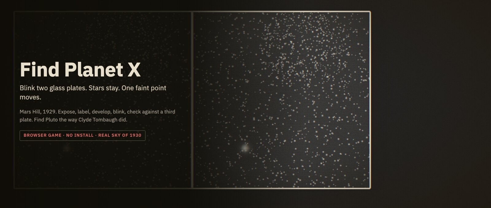

# Find Planet X



**Mars Hill, 1929.** You are the Kansas farm boy Lowell Observatory just hired. The ninth planet is a
faint point that moves between two glass plates, and nobody knows where it is. Find it the way Clyde
Tombaugh did.

**Play:** https://thevangelist.github.io/find-planet-x/ · no install, runs in the browser.

## How the search works

1. **Expose.** On a clear, moonless night turn the 13-inch astrograph to a field above the pines and
   guide for an hour. The real sky of 1929–30: 2 000 catalogue stars, planets, the Moon, the Milky Way.
2. **Label.** Write the field on the sleeve. Only the label is remembered.
3. **Second plate.** Expose the same field again, another night, within two weeks. Two plates of one
   field are a pair.
4. **Develop.** Pull each plate from the bath when the marker sits in the middle. Too early is thin,
   too late is fogged.
5. **Blink.** At the Zeiss comparator switch between plate A and B. Stars stay. Anything that jumps gets
   a pencil ring and a guess: asteroid, comet, variable, flaw, or Planet X.
6. **Check.** A third plate settles every ring. Asteroids jump far, flaws vanish, Planet X creeps a
   few millimetres.

The footer follows your current field through those steps. Coffee sharpens, sleep restores, the
notebook is the only memory, and the programme slips into chaos if plates go unlabelled.

Along the way you can also find a few of Tombaugh's real asteroids, comets and variable stars.

## Controls

| Where | Keys |
|---|---|
| Dome | drag or arrow keys / WASD to turn the telescope, click a field to expose, buttons for the hour |
| Exposure | arrow keys / WASD to keep the guide star centred |
| Darkroom | `Space` pulls the plate from the bath |
| Comparator | `←` `→` plate A / B, `Space` flips, `B` side by side, `P` pencil, `N` negative, `Esc` leaves |
| Plates | `←` `→` previous / next plate, `Esc` closes |
| Anywhere | `M` sound on / off, Settings bottom right |

## Run locally

```
./serve.sh
```

Then open http://localhost:8765. Audio needs http, not `file://`. No build step, no dependencies
beyond three.js from a CDN for the 3D dome (the flat chart works without it).

`?pluto` in the URL paints Planet X big and red on both charts, for testing the discovery.

## Project

- `js/game.js` day loop, places, notebook, calendar, plate gallery
- `js/sky.js` plate rendering: star fields, movers, grain
- `js/blink.js` the comparator, `js/expose.js` guiding, `js/dome3d.js` the dome, `js/skymap.js` the chart
- `js/astro.js` time, sky, weather, Moon, planets · `js/finds.js` Tombaugh's real discoveries
- `js/audio.js` ambience layers and effects · `js/text.js` every line of narration
- `DESIGN.md` tokens and the button family · `CREDITS.md` images, sounds, catalogue

Images, sounds and the star catalogue are credited in [CREDITS.md](CREDITS.md).
